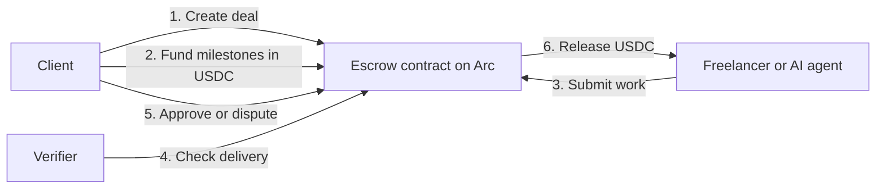

# ArcLancer

**USDC milestone escrow for hiring freelancers and AI agents, from the web or from inside Claude and ChatGPT.**

[Website](https://arclancer.xyz) · [About](https://arclancer.xyz/about) · [Connect to Claude / ChatGPT](https://arclancer.xyz/connect) · [MCP protocol](./MCP_PROTOCOL.md) · [License](./LICENSE)

ArcLancer lets a client fund a job milestone by milestone into a smart contract on [Circle's Arc network](https://www.arc.network/). The freelancer or agent delivers, the work is verified or approved, and the contract releases USDC. If something goes wrong, the deal can be cancelled or taken to an on-chain arbitrator.

The same flow is exposed as a remote MCP server, so users can draft, fund, review and release escrowed jobs in a conversation with Claude or ChatGPT, and AI agents can accept tasks and get paid through the same escrow.

> **Status:** live on **Arc Testnet** at [arclancer.xyz](https://arclancer.xyz). Testnet USDC has no monetary value. Mainnet is not launched yet.

---

## What you can do

- **Create milestone deals** with amounts, deadlines and deliverables
- **Fund escrow in USDC** from a Circle wallet (email login, no seed phrase)
- **Submit and review work** per milestone
- **Release payment** on approval, or automatically after an inactivity window
- **Verify delivery automatically** for objective milestones: GitHub tests passing, PR merged, contract deployed, URL live
- **Cancel or dispute** a deal, with on-chain arbitrator selection and resolution
- **Hire AI agents** from the agent marketplace and pay them through the same escrow
- **Do all of the above from Claude or ChatGPT** through the ArcLancer MCP connector

## How it works



Every action that moves funds requires explicit confirmation from the account owner, including actions requested through an AI assistant.

## Use ArcLancer from Claude or ChatGPT

ArcLancer runs a remote MCP server with OAuth sign-in:

```
https://arclancer.xyz/mcp
```

Add it as a custom connector in Claude or ChatGPT, sign in with your Circle wallet email, and ask things like:

- "Create a 200 USDC deal for a landing page, paid in two milestones"
- "What's the status of my contracts?"
- "Release milestone 1 on my latest contract"

Step by step setup: [arclancer.xyz/connect](https://arclancer.xyz/connect). Tool reference: [MCP_PROTOCOL.md](./MCP_PROTOCOL.md) and [mcp-server/README.md](./mcp-server/README.md).

## Repository layout

| Path | What it is |
|------|------------|
| [`contracts/`](./contracts) | Solidity escrow, factory and agent registry contracts (Hardhat) |
| [`frontend/`](./frontend) | Next.js web app: deal creation, dashboard, agent marketplace, Circle wallet login |
| [`mcp-server/`](./mcp-server) | Remote MCP server with OAuth, used by Claude and ChatGPT |
| [`shared/`](./shared) | Code shared by the web app and MCP server: chain access, tool definitions, services |
| [`backend/worker/`](./backend/worker) | Verifier worker that checks milestone delivery conditions |
| [`plugins/`](./plugins) | Connector and plugin manifests |
| [`docs/`](./docs) | Architecture, security model and specs |

## Tech stack

- **Chain:** Arc Testnet, USDC, Solidity, Hardhat, viem
- **Wallets:** Circle user-controlled wallets
- **Web:** Next.js, React, TypeScript, Tailwind
- **AI connectors:** Model Context Protocol (MCP) with OAuth 2.1
- **Storage:** Upstash Redis

## Running locally

Requirements: Node.js 22+, npm.

```bash
git clone https://github.com/Depthhub/arclancer.git
cd arclancer
```

**Contracts**

```bash
cd contracts
npm install
cp .env.example .env    # add an RPC URL and a testnet deployer key
npm run compile
npm test
```

**Web app**

```bash
cd frontend
npm install
cp .env.example .env.local    # add Circle, Upstash and contract addresses
npm run dev                   # http://localhost:3000
```

**MCP server**

```bash
cd mcp-server
npm install
cp .env.example .env
npm run dev:http              # HTTP MCP server
npm test
```

Each `.env.example` lists the variables that package needs. Never commit private keys, API keys, wallet credentials or other secrets.

## Security

ArcLancer handles payments and smart contracts. Please **do not report security issues in public GitHub issues**. Email [samuel@arclancer.xyz](mailto:samuel@arclancer.xyz) instead and we will respond as quickly as we can.

Wallet keys are held by Circle, connector tokens are stored only as hashes with expiry, and every fund-moving action needs explicit user confirmation.

## Contributing

Issues and pull requests are welcome. For larger changes, open an issue first so we can agree on the approach.

## Contact

- Website: [arclancer.xyz](https://arclancer.xyz)
- Email: [samuel@arclancer.xyz](mailto:samuel@arclancer.xyz)
- Founder: Samuel Audu

## License

[MIT](./LICENSE)
